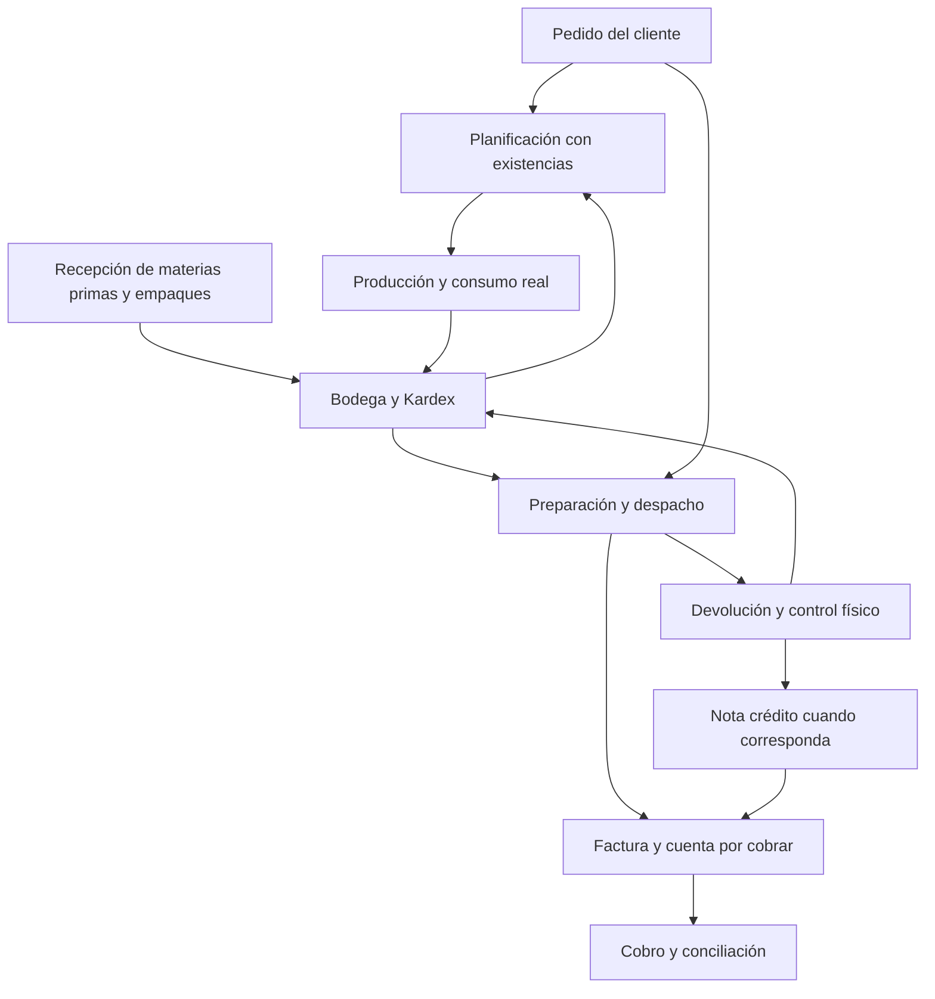
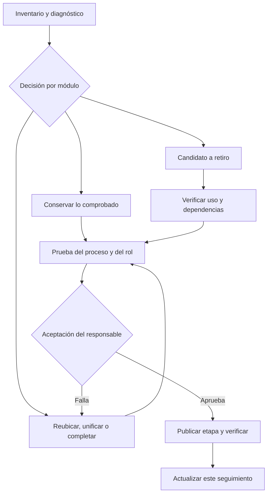

# CIBUSPAN ONE: auditoría de estructura y plan de reorganización

> En pausa por indicación de Iván (27/10/2026): arranque de inventarios, seguimiento ORG-07. El módulo ya está instalado, verificado y publicado (Cloudflare 10e6b372). Quedan pendientes conteo físico real, fecha de inicio, revisión de pedidos/reservas, vista previa y confirmación del corte. No se aplicó ningún conteo. Retomar sólo cuando Iván lo indique; frase de referencia: «Retomemos el arranque de inventarios». Sin fecha ni recordatorio programado. No reinstalar ni volver a pedir la terminal confirmada. Los pedidos continúan al día.

Fecha: 23 de octubre de 2026, Ecuador. Estado: primera revisión de navegación y arquitectura; propuesta para revisión con Iván. Base oficial: main dac28b1f68c5908ccc361266f50b222831433699. No se cambió ninguna pantalla, menú, permiso, base de datos o despliegue.

## Decisión recomendada

Renovar progresivamente el mismo producto en un entorno de prueba separado. Conservar código, datos, reglas comprobadas y repositorio oficial; no empezar otro sistema independiente ni copiar y pegar pantallas sin sus dependencias. La app actual permanece operativa. Se revisa y acepta cada módulo antes de habilitarlo para los usuarios. No hace falta esperar a terminar todos los módulos para mejorar una parte comprobada.

La metáfora de cambio de casa es útil para ordenar y decidir qué conservar. No significa mover manualmente datos de producción hacia otra base que se vaya desactualizando: la base real sigue recibiendo operaciones. Para pruebas de escritura usar base de ensayo aislada. Al publicar, conectar la versión aprobada con la fuente real vigente y ejecutar sólo los cambios de esquema necesarios y revisados. Una migración física de la base sería un proyecto aparte, sólo si aparece una necesidad concreta.

## Alcance y límites de esta auditoría

Revisión real de Layout.tsx, switch de App.tsx, permisosAplicacion.ts y pantallas relacionadas: DashboardV2, Reportes, Administracion, KpiKam, VisitasRotacion/CampoComercial, ProduccionV2 y módulos de descuentos/correos. Inventario completo de enlaces del submenú en el apéndice. Se distinguieron componentes y parámetros de apertura.

No se inspeccionó la sesión en vivo ni la base real, almacenamiento o registros de uso. No se certificó qué versión está publicada ni qué funciones usan diariamente los empleados. Tener componente no demuestra proceso terminado, dato correcto ni instalación en producción. La revisión de cálculos, fuentes SQL, roles reales, errores y recorridos de cada módulo es la siguiente fase. No se concluye que haya datos duplicados sólo porque existan dos accesos. Los archivos antiguos tampoco se declaran descartables sin revisar dependencias.

## Hallazgos comprobados

53 opciones de submenú, además de Inicio. 39 tienen componente asignado y 14 abren PantallaEnConstruccion. 89 nombres de ruta reconocidos por el switch, incluidos alias antiguos y accesos internos; no equivalen a 89 módulos. Siete grupos de opciones visibles abren idéntico componente con idénticos parámetros. Los conteos se obtuvieron del código; los permisos pueden reducir lo que ve cada usuario.

| ID | Hallazgo | Evidencia | Acción propuesta |
| --- | --- | --- | --- |
| H01 | Comercial/Pedidos y Producción/Pedidos abren PedidosV2 | App.tsx | Un solo proceso dueño en Comercial; Producción puede tener consulta enlazada y filtrada a pendientes. No duplicar pedido. |
| H02 | Resumen, Planificación y Producción abren ProduccionV2 sin cambiar vista inicial | App.tsx | Unificar acceso o crear vistas con funciones realmente distintas. El historial sí abre vista específica y no se cuenta como duplicación idéntica. |
| H03 | Tres Análisis abren el mismo Reportes general | App.tsx, Reportes.tsx | Definir un catálogo común de reportes, entradas por contexto y filtros conservados. Evitar tres nombres que prometan análisis diferentes. |
| H04 | Resumen e Inventario abren InventarioV2 | App.tsx | Una consulta de existencias; resumen sólo si responde preguntas gerenciales diferentes. |
| H05 | Kardex aparece en Inventario y Compras y abre el mismo componente sin filtro inicial | App.tsx | Dueño en Bodega; desde Compras, enlace al mismo Kardex con alcance MP/empaques. Conservar permisos necesarios. |
| H06 | Preparación y Despachos abren DespachosV2 sin parámetros diferentes | App.tsx | Separar preparar/confirmar sólo cuando exista diferencia real de tareas/estados; mientras tanto, un acceso principal. |
| H07 | Compras/Facturas y Finanzas/Resumen, Cuentas por Pagar, Pagos e Historial abren PagosGastos sin contexto inicial | App.tsx | Documento único de proveedor; separar consulta, obligación y pago como vistas del mismo proceso. No crear otra factura. |
| H08 | Administración también tiene accesos a materias primas, fórmulas, costos indirectos, facturas/pagos, roles y simulador | Administracion.tsx | Tratar como atajos o mover navegación al bloque dueño. Administración queda para maestros/configuración/permisos. Roles de pago sigue en Finanzas. |
| H09 | Reportes combina operación semanal, facturación importada, devoluciones y rentabilidad, y enlaza Supervisión KAM | Reportes.tsx | Supervisión y revisión de visitas en Comercial; catálogo de reportes con dueño y fuente claros. |
| H10 | Comercial tiene resumen en DashboardV2, KpiKam y analítica de visitas; no todos miden lo mismo | DashboardV2.tsx, KpiKam.tsx, CampoComercial.tsx | Definir nivel ejecutivo, tablero del área y consulta detallada. No eliminar tableros útiles por compartir cliente/SKU. |
| H11 | Semielaborados del menú está en construcción, pero EtiquetadoSemielaborados sí existe bajo Etiquetado y alias Semielaborados | App.tsx | Etiquetar no equivale a fabricar/consumir/controlar stock de semielaborados; verificar recorrido completo antes de declarar módulo listo. |
| H12 | Hay nombres antiguos en rutas y varias versiones de archivos | App.tsx y árbol de src/pages | Compatibilidad no es duplicación de datos. Rastrear importaciones/dependencias antes de archivar; no borrar por el nombre V2. |
| H13 | Mismo componente accesible con permisos diferentes según ruta | permisosAplicacion.ts | Auditar por rol antes de consolidar. Ejemplo: Kardex de Compras depende de Materias primas; Kardex de Inventario depende de Inventario. No ampliar ni perder acceso inadvertidamente. |
| H14 | Correos de descuentos están programados pero falta configuración/instalación/despliegue y prueba real | docs/CORREOS_DESCUENTOS.md y continuidad | Estado "programado, pendiente de activar", no "terminado". Se acordó futura cuenta avisos@cibuspan.com; falta dirección definitiva y configuración privada. No activar el remitente personal anterior como si siguiera aprobado. |

### Opciones visibles en construcción

- Producción: Semielaborados.
- Compras: Resumen, Proveedores, Costos, Historial, Análisis.
- Finanzas: Cuentas por Cobrar, Cobros y Conciliación, Tesorería.
- Administración: Maestros, Configuración, Importaciones, Auditoría, Sistema.

Estos son destinos sin desarrollo propio, no prueba de ausencia total de esa capacidad: por ejemplo, hay gestión de maestros e importaciones dentro de otras pantallas. También hay tarjetas internas deshabilitadas, como Empaques y Parámetros en Administración. Se debe localizar la capacidad existente antes de programarla otra vez.

## Estructura objetivo propuesta

Siete bloques principales. Cada operación tiene un dueño; otros bloques consumen o enlazan la misma información.

| Bloque | Qué debe contener | Límite para evitar duplicaciones |
| --- | --- | --- |
| Dirección | Tablero ejecutivo: rentabilidad, ventas, devoluciones, caja, cumplimiento y alertas; acceso a detalles | Consulta y decisiones. No registrar pedidos, facturas ni repetir maestros. Conservar DashboardV2 y costos/gastos por devengo hasta revisión y aceptación. |
| Comercial | Clientes y acuerdos, pedidos, descuentos, ventas, devoluciones comerciales, visitas, supervisión, revisión de lecturas, KPI y acciones KAM | Pedido y condiciones comerciales se registran una vez. Sell-in y sell-out se identifican claramente; sell-out estimado no se presenta como venta comprobada. |
| Producción | Fórmulas, planificación por pedidos/stock, órdenes, producción real, consumo MP/empaques, semielaborados, rendimientos, lotes, etiquetado e historial | Planificar no suma existencias. Confirmar producción genera movimientos una sola vez. Etiquetado usa esa misma orden/lote. |
| Bodega y Despachos | MP, empaques, semielaborados y PT; recepciones físicas, Kardex, ajustes, vencimientos, preparación, despacho, retorno físico y documentos | Fuente única de existencias y movimientos; no otros inventarios independientes en Compras o Comercial. Retornos deben pasar control antes de ser disponibles para venta. |
| Compras y Abastecimiento | Proveedores, necesidades de compra, órdenes de compra, seguimiento de recepción y documentos de compra | Recepción física enlaza a Bodega; factura del proveedor enlaza a Finanzas, sin registrar otra copia. Funciones faltantes se validan antes de desarrollarse. |
| Finanzas y Costos | Facturas por cobrar/pagar, notas crédito, cobros, pagos, tesorería, nómina, devengo, clasificación, resultados, rentabilidad y simulaciones | Facturar, cobrar y pagar son eventos distintos. Una fórmula de cada KPI y trazabilidad al origen. Roles de pago permanece aquí. |
| Administración y Sistema | Usuarios/permisos, catálogos compartidos, configuración, importaciones según dominio, auditoría de cambios, notificaciones e integraciones | Maestros únicos de cliente, proveedor, SKU, MP, unidades, local y usuario. No confundir auditoría del sistema con revisión de capturas de Comercial. |

No crear una nueva pantalla para cada nombre si no hay una tarea, indicador o decisión diferente. Un reporte compartido puede tener varios accesos, pero debe abrir el contexto correcto y conservar una sola definición del dato.

## Flujo operativo objetivo

La devolución no vuelve automáticamente al stock vendible: la flecha representa control, movimiento y ajuste según su disposición. La planificación debe conciliar demanda pendiente, existencias disponibles y producción; no ordena producir dos veces un pedido ya cubierto. El flujo es el diseño objetivo, no una certificación de que todas las conexiones estén terminadas hoy.

## Tres niveles de información

1. Dirección: pocas métricas y alertas, comparables y con fuente clara.
2. Gestión de cada bloque: pendientes, rendimiento y decisiones del responsable.
3. Operación/detalle: documentos y registros que explican la métrica y permiten actuar.

Para cada indicador documentar nombre, fórmula, fechas, unidades, fuente, filtros y tratamiento de anulaciones/duplicados. Ejemplo: ventas facturadas, pedidos y despachos no son la misma medida; gasto devengado y pago tampoco. Todas las vistas deben consumir la misma definición validada. No se fusionarán resultados numéricos hasta comparar fuentes y periodos.

## Método de auditoría por módulo

Ficha obligatoria: ID, dueño, usuarios/roles, tarea, entradas, salidas, tablas/RPC, pantallas y accesos actuales, nueva ubicación, dependencias, estado de código, instalación, validación con datos, publicación y decisión. Decisiones permitidas: conservar, reubicar, unificar, completar, retirar tras verificar.

Una pantalla se considera terminada sólo si: proceso definido, guardado y consulta comprobados, permisos correctos, resultado conciliado, errores visibles, prueba por usuario responsable, publicada y comprobada en la app real. "Compila" o "archivo existente" no bastan.

Estados de seguimiento: Por revisar → Diagnosticado → Decidido → En adaptación → En prueba → Aceptado → Publicado. Retirado sólo con prueba de que no se usa, no rompe dependencias y los datos/documentos permanecen accesibles.

## Tablero inicial de seguimiento

| ID | Entregable | Estado actual | Prioridad | Criterio de cierre |
| --- | --- | --- | --- | --- |
| ORG-01 | Inventario de menús, rutas y destinos | Diagnosticado | Alta | Apéndice contrastado con main; recorrido por roles pendiente. |
| ORG-02 | Confirmar siete bloques, dueños y nombres con Iván | Mapa base aceptado para comenzar; responsables por precisar | Alta | Mapa aceptado y registrado antes de mover navegación. |
| ORG-03 | Entorno de prueba separado | Por preparar | Alta | URL de ensayo, base de ensayo, accesos y envíos aislados; app actual sigue operativa. |
| ORG-04 | Recorrido real por rol | Por revisar | Alta | Iván, pedidos, producción, bodega, facturación, KAM y mercaderista completan sus tareas. |
| ORG-05 | Catálogo de indicadores y fuentes | Por revisar | Alta | Cada KPI tiene fórmula y fuente únicas y resultados conciliados. |
| ORG-06 | Pedidos/planificación/producción | OP-13/consumo MP instalados; alta transaccional de pedidos OP-02 instalada/verificada/publicada (terminal 27/10, fbafd456), validar uso real; conteo/histórico en pausa | Alta | Pedido no se duplica y consumo/alta de PT ocurre una vez. |
| ORG-07 | Stock/Kardex/saldos iniciales/importación | Módulo instalado/verificado/publicado (10e6b372); conteo real/corte EN PAUSA por Iván el 27/10 | Alta | MP/PT concilian con movimientos y corte; ajustes trazables. |
| ORG-08 | Preparación/despacho/documentos/devolución | Confirmación con factura/conciliación/stock y recuperación preparada en 202610270002; instalar/publicar y validar; parcial por definir | Alta | Flujo completo sin doble descarga de stock y retorno controlado. |
| ORG-09 | Ventas/descuentos/acuerdos/correos | Por revisar en vivo | Alta | Fuente comercial clara, correo de empresa activado y no duplica descuentos. |
| ORG-10 | Visitas/rotación/revisión/supervisión/KAM | Estructura diagnosticada | Alta | Separar registrar, revisar y analizar; conservar registros diarios y datos manuales. |
| ORG-11 | Facturas/CxP/pagos/historial | Accesos diagnosticados | Alta | Mismo documento, vistas diferenciadas y saldo conciliado. |
| ORG-12 | Costos/devengo/resultados/rentabilidad | Por revisar cálculos | Alta | Comparación de periodos, devengo y fuentes; conservar panel estable hasta aceptación. |
| ORG-13 | Compras/abastecimiento/proveedores | Destinos incompletos detectados | Media | Identificar lo existente y decidir qué proceso falta antes de crear otro. |
| ORG-14 | CxC/cobros/conciliación/tesorería | Destinos incompletos detectados | Alta | Definir prioridades y capacidades reales; no suponer que son módulos terminados. |
| ORG-15 | Semielaborados/empaques/etiquetado | Ambigüedad detectada | Media | Fabricación, consumo, inventario y etiqueta identificados por separado. |
| ORG-16 | Maestros/configuración/auditoría/importaciones | Distribución diagnosticada; OP-12 instalado/verificado, usuarios reales pendientes | Media | Una fuente por entidad y permisos correctos; accesos en bloque dueño. |
| ORG-17 | Código legado y dependencias | Por revisar | Baja | Grafo de importaciones, rutas y usos verificado antes de archivar. |
| ORG-18 | Publicación por etapas y reversión | Por definir | Alta | Criterios de aceptación, punto de retorno y verificación tras cada publicación. |

ORG-01 sólo cubre navegación en código; no cierra la auditoría funcional. No hay desarrollos nuevos ni entornos creados en esta revisión.

## Renovación mientras se trabaja en la app actual

| Aspecto | App en uso | Versión de prueba |
| --- | --- | --- |
| Usuarios | Operación diaria | Iván y usuarios de prueba designados |
| Código | Versión publicada conocida | Cambios del mismo repositorio y componentes reutilizados |
| Datos | Fuente real vigente | Datos de ensayo aislados, sin duplicar operaciones reales |
| Correos | Sólo comunicaciones autorizadas al habilitarlas | Desactivados o dirigidos exclusivamente a destinatarios de prueba |
| Cambios de esquema | Sólo migración revisada y necesaria | Probar primero; no ejecutar todo el historial de migraciones a ciegas |
| Aceptación | Conserva funciones actuales | Se incorpora por módulo cuando el responsable acepta el resultado |

Crear una URL de prueba no aísla por sí solo la base, archivos, autenticación o correo: deben configurarse aparte. Cloudflare permite previews; Supabase documenta entornos de ensayo separados. Elegir mecanismo y comprobar disponibilidad/coste antes de crear recursos. Fuentes oficiales: https://developers.cloudflare.com/pages/configuration/preview-deployments/ y https://supabase.com/docs/guides/deployment/managing-environments.

Mantener main como fuente oficial, respetando AGENTS.md. Este informe no cambia la política de ramas ni crea otro repositorio. No prometer acceso de prueba ni despliegue sin crearlos y comprobarlos. No hay sesiones autenticadas de Cloudflare/Supabase disponibles en esta revisión.

## Próxima tarea

Iván indicó «ok, empecemos» el 23/10/2026: usar los siete bloques como base de trabajo. Ya se recorrió el código y se leyó el diagnóstico del servidor; ver docs/RESULTADO_REVISION_OPERATIVA_20261023.md. OP-12 y OP-13 instalados/verificados, OP-13 publicado según terminal posterior de Iván. OP-07 diario instalado/verificado/publicado según resultado recibido el 24/10/2026. Decisión posterior de Iván: priorizar corte físico de arranque de producción/bodega y conservar pedidos al día; regularización histórica en pausa. Ver docs/ARRANQUE_OPERATIVO.md. Módulo de corte instalado/verificado/publicado (SQL 202610240001), confirmado por terminal del 27/10/2026 y Cloudflare 10e6b372. Conteo real y aplicación del corte pendientes. Fecha se elige cuando esté listo; validación con usuarios pendiente. Precisar responsables, numeración, stock de seguridad y entrega parcial antes de cambiar sus reglas. No empezar por diseñar otra portada ni borrar pantallas. La información de revisión se registra con los IDs ORG y OP, no sólo en mensajes de chat.

## Apéndice: inventario de submenús actual

"Con pantalla" significa que la ruta abre ese componente; no que el módulo esté probado o terminado. "En construcción" describe el destino directo. Historial de producción conserva sus parámetros propios. Los alias antiguos fuera del submenú no se cuentan de nuevo.

| Bloque / ruta actual | Etiqueta | Destino en código | Estado observado |
| --- | --- | --- | --- |
| Comercial · Pedidos | Pedidos | `PedidosV2` | Con pantalla; validar proceso |
| Comercial · Ventas | Ventas | `VentasClienteSku` | Con pantalla; validar proceso |
| Comercial · Devoluciones | Devoluciones | `Devoluciones` | Con pantalla; validar proceso |
| Comercial · Descuentos | Descuentos | `DescuentosPromociones` | Con pantalla; validar proceso |
| Comercial · Visitas y rotación | Visitas y rotación | `VisitasRotacion cambiarPantalla={setPantalla}` | Con pantalla; validar proceso |
| Comercial · Visitas diarias | Visitas diarias | `VisitasDiarias cambiarPantalla={setPantalla}` | Con pantalla; validar proceso |
| Comercial · Revisión de datos | Revisión de datos | `RevisionDatosVisitas` | Con pantalla; validar proceso |
| Comercial · KPI KAM | Gestión Comercial | `KpiKam cambiarPantalla={setPantalla}` | Con pantalla; validar proceso |
| Producción · Resumen | Resumen | `ProduccionV2` | Con pantalla; validar proceso |
| Producción · Pedidos | Pedidos | `PedidosV2` | Con pantalla; validar proceso |
| Producción · Planificación | Planificación | `ProduccionV2` | Con pantalla; validar proceso |
| Producción · Producción | Producción | `ProduccionV2` | Con pantalla; validar proceso |
| Producción · Fórmulas | Fórmulas | `Formulas` | Con pantalla; validar proceso |
| Producción · Semielaborados | Semielaborados | `PantallaEnConstruccion titulo={pantalla}` | En construcción |
| Producción · Etiquetado | Etiquetado | `EtiquetadoSemielaborados` | Con pantalla; validar proceso |
| Producción · Historial | Historial | `ProduccionV2 vistaInicial="INGRESADA" soloHistorial` | Con pantalla; validar proceso |
| Producción · Análisis | Análisis | `Reportes cambiarPantalla={setPantalla}` | Con pantalla; validar proceso |
| Inventario y Despachos · Resumen | Resumen | `InventarioV2` | Con pantalla; validar proceso |
| Inventario y Despachos · Inventario | Inventario | `InventarioV2` | Con pantalla; validar proceso |
| Inventario y Despachos · Kardex | Kardex | `KardexInventario` | Con pantalla; validar proceso |
| Inventario y Despachos · Preparación | Preparación | `DespachosV2` | Con pantalla; validar proceso |
| Inventario y Despachos · Despachos | Despachos | `DespachosV2` | Con pantalla; validar proceso |
| Inventario y Despachos · Documentos | Documentos | `Documentos cambiarPantalla={setPantalla}` | Con pantalla; validar proceso |
| Inventario y Despachos · Historial | Historial | `HistorialDespachos` | Con pantalla; validar proceso |
| Inventario y Despachos · Análisis | Análisis | `Reportes cambiarPantalla={setPantalla}` | Con pantalla; validar proceso |
| Compras · Resumen | Resumen | `PantallaEnConstruccion titulo={pantalla}` | En construcción |
| Compras · Proveedores | Proveedores | `PantallaEnConstruccion titulo={pantalla}` | En construcción |
| Compras · Facturas | Facturas | `PagosGastos` | Con pantalla; validar proceso |
| Compras · Materias Primas y Empaques | Materias Primas y Empaques | `MateriasPrimas` | Con pantalla; validar proceso |
| Compras · Costos | Costos | `PantallaEnConstruccion titulo={pantalla}` | En construcción |
| Compras · Kardex | Kardex | `KardexInventario` | Con pantalla; validar proceso |
| Compras · Historial | Historial | `PantallaEnConstruccion titulo={pantalla}` | En construcción |
| Compras · Análisis | Análisis | `PantallaEnConstruccion titulo={pantalla}` | En construcción |
| Pagos y Finanzas · Resumen | Resumen | `PagosGastos` | Con pantalla; validar proceso |
| Pagos y Finanzas · Cuentas por Cobrar | Cuentas por Cobrar | `PantallaEnConstruccion titulo={pantalla}` | En construcción |
| Pagos y Finanzas · Cobros y Conciliación | Cobros y Conciliación | `PantallaEnConstruccion titulo={pantalla}` | En construcción |
| Pagos y Finanzas · Cuentas por Pagar | Cuentas por Pagar | `PagosGastos` | Con pantalla; validar proceso |
| Pagos y Finanzas · Pagos | Pagos | `PagosGastos` | Con pantalla; validar proceso |
| Pagos y Finanzas · Roles de pago | Roles de pago | `RolesPago` | Con pantalla; validar proceso |
| Pagos y Finanzas · Tesorería | Tesorería | `PantallaEnConstruccion titulo={pantalla}` | En construcción |
| Pagos y Finanzas · Resultados | Resultados | `CostosIndirectos` | Con pantalla; validar proceso |
| Pagos y Finanzas · Importación contable | Importación contable | `ImportacionContable cambiarPantalla={setPantalla}` | Con pantalla; validar proceso |
| Pagos y Finanzas · Clasificación de gastos | Clasificación | `ClasificacionGastos` | Con pantalla; validar proceso |
| Pagos y Finanzas · Rentabilidad | Rentabilidad | `RentabilidadComercial` | Con pantalla; validar proceso |
| Pagos y Finanzas · Historial | Historial | `PagosGastos` | Con pantalla; validar proceso |
| Pagos y Finanzas · Análisis | Análisis | `Reportes cambiarPantalla={setPantalla}` | Con pantalla; validar proceso |
| Administración · Resumen | Resumen | `Administracion cambiarPantalla={setPantalla}` | Con pantalla; validar proceso |
| Administración · Usuarios y Permisos | Usuarios y Permisos | `UsuariosPermisos` | Con pantalla; validar proceso |
| Administración · Maestros | Maestros | `PantallaEnConstruccion titulo={pantalla}` | En construcción |
| Administración · Configuración | Configuración | `PantallaEnConstruccion titulo={pantalla}` | En construcción |
| Administración · Importaciones | Importaciones | `PantallaEnConstruccion titulo={pantalla}` | En construcción |
| Administración · Auditoría | Auditoría | `PantallaEnConstruccion titulo={pantalla}` | En construcción |
| Administración · Sistema | Sistema | `PantallaEnConstruccion titulo={pantalla}` | En construcción |

Inicio abre DashboardV2 y no está incluido entre las 53 opciones de submenú.

Avance 23/10/2026: ver docs/AUDITORIA_FLUJO_OPERATIVO.md. Se rastrearon páginas/repositorios/SQL disponibles; faltan definiciones reales de funciones base. Preparada consulta de sólo lectura y exportador. Etapa 3 sigue abierta; no se alteró la app.

Actualización posterior del mismo día: diagnóstico recibido, funciones base leídas y pruebas locales realizadas; ver docs/RESULTADO_REVISION_OPERATIVA_20261023.md. No repetir la exportación completa ni marcar la etapa 3 terminada. El informe privado conserva los detalles de autorización y el diagnóstico completo fuera del repositorio público.

Avance OP-12: instalado/verificado según terminal de Iván; ver docs/AUTORIZACION_OPERATIVA.md. OP-13 instalado/verificado/publicado según Texto pegado(3).txt: main d12e18b, repair 202610230002, Cloudflare 4e741568; ver docs/REGISTRO_PRODUCCION_SEGURO.md. Falta validación operativa por usuarios. No cambiar menús ni reimportar existencias. OP-07 de nuevas fabricaciones instalado/verificado/publicado según Texto pegado(5).txt recibido 24/10/2026: f11fe8a, repair 202610230003, Cloudflare 7faeb857. Ver docs/CONSUMO_MP_PRODUCCION.md. No consume históricos ni automatiza empaque al etiquetar/micros; validación operativa pendiente. Cambio de prioridad del 24/10/2026: preparar corte físico de arranque con vista previa y trazabilidad, conservar pedidos y dejar histórico en pausa. Ver docs/ARRANQUE_OPERATIVO.md; módulo de corte con SQL 202610240001 instalado/verificado/publicado, terminal del 27/10/2026 y Cloudflare https://10e6b372.cibuspan-one.pages.dev. No se aplicó ningún conteo; preparar físico real y revisar vista previa, sin reinstalar ni repetir la terminal. Fecha al estar listo, no pedirla para programar. No se resetearon saldos. Después continuar pedido transaccional. Etapa 3 abierta.

Actualización del 27/10/2026 posterior a la pausa del arranque: Iván autoriza continuar con el siguiente paso. OP-02 (alta de pedido completa y recuperable) instalado/verificado/publicado según terminal del 27/10/2026: Cloudflare fbafd456 y mensaje final de scripts/Instalar-RegistroPedidosSeguro.ps1. No repetir instalación ni pedir nuevamente ese resultado. Ver docs/REGISTRO_PEDIDOS_SEGURO.md. No reactivar ORG-07 por esta instalación. No modificar stock, estados de despachos, reglas de parcial o numeración por cliente. Validación operativa, eliminación transaccional y demás conexiones siguen abiertas.

Avance posterior del 27/10/2026: OP-10 y eliminación segura preparados y probados; SQL 202610270002 y scripts/Instalar-OperacionesLogistica.ps1 pendientes de instalar/verificar/publicar. Ver docs/OPERACIONES_LOGISTICA_SEGURAS.md. Pedidos OP-02 ya instalados/verificados/publicados (fbafd456), sin reinstalar. La regla de parcial no cambia. Preparar/liberar reserva conservan funciones actuales y no reciben comprobante nuevo en esta entrega. No se ejecutaron eliminaciones/despachos ni se reanudó ORG-07; validación real y etapa 3 abiertas.
