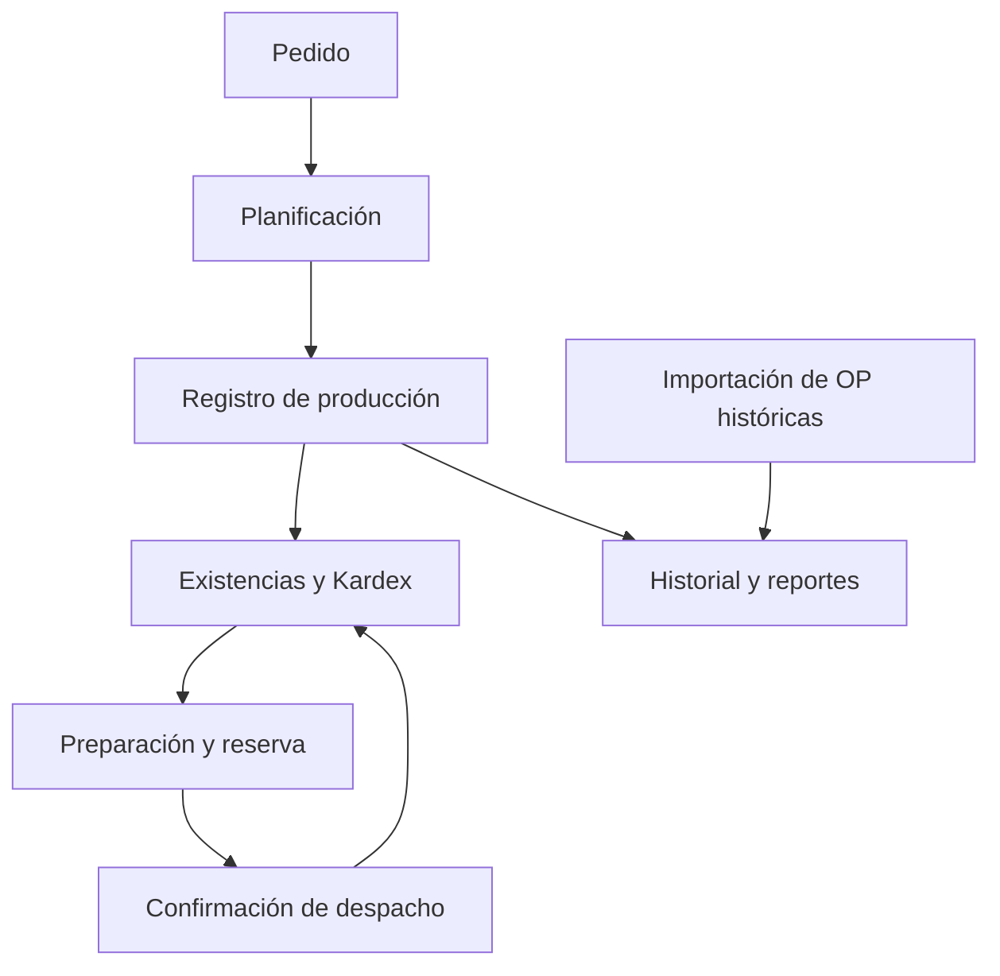

# Auditoría del recorrido pedido producción inventario despacho

Fecha: 23/10/2026. Etapa 3 de la lista de control de Iván. Base inicial: main 033d3326516ccf92dfb252165fab95e3eb5b31ea. Actualización: recibido el diagnóstico del servidor y reproducidos los comportamientos principales en ensayo local; ver docs/RESULTADO_REVISION_OPERATIVA_20261023.md. Pendientes correcciones, reglas de negocio y prueba con usuarios. No se modificó la app ni se ejecutaron operaciones sobre datos reales.

Las secciones siguientes conservan la revisión inicial anterior al diagnóstico. Sus pendientes sobre funciones base se actualizan en el informe de resultado; no volver a pedir la misma exportación. La evidencia completa se conserva en el paquete privado de Iván, no en este repositorio público.

## Resultado para Iván

Hay conexiones implementadas entre las pantallas y la base. No necesitamos reconstruir el sistema desde cero. Antes de reorganizar los accesos debemos cerrar tres diferencias importantes:

1. Importar una orden histórica para reportes no equivale a ingresar producción que aumenta existencias. El importador actual es explícitamente sólo histórico.
2. Inventario permite aumentar existencias manualmente y Producción registra producción por otro camino. Pueden ser operaciones legítimas distintas; hace falta definir el documento dueño de cada entrada y evitar registrar la misma fabricación dos veces.
3. Las reglas centrales de planificación, producción y despacho se ejecutan mediante funciones de Supabase que no están definidas en los archivos SQL del repositorio. No podemos certificar consumo de materias primas, disponibilidad o protección ante doble confirmación sólo leyendo los botones.

Siguiente tarea: obtener una copia de sólo lectura de esas definiciones del servidor. No volver a cargar pedidos/producciones ni reiniciar el inventario como prueba.

## Alcance y grados de evidencia

Se revisaron páginas, repositorios, importador histórico, vistas de historial, migraciones Kardex/inicio de octubre y llamadas al servidor. «Comprobado en código» no significa instalado en producción. «Por verificar en servidor» indica que falta su definición real y sus dependencias; no demuestra una falla real.

No hubo acceso autenticado a la base real, ni se consultaron existencias/pedidos reales. No se asignan responsables personales: los roles de la matriz son propuesta para validar con Iván. Una prueba local de Kardex usa reservas simuladas y no certifica el motor FEFO real.

## Matriz del recorrido

| Paso y responsable propuesto | Pantalla y origen | Qué se registra o cambia | Estado y decisión |
| --- | --- | --- | --- |
| Ingresar pedido — Pedidos/Comercial | PedidosV2; pedidoRepository | Inserta pedidos INGRESADO y sus pedido_detalles. Consulta cliente, bodega, catálogo y unidad de manejo. | Conservar como origen único. No suma ni descuenta stock en este código cliente. Revisar restricciones y atomicidad real. |
| Planificar — Producción | ProduccionV2; RPC obtener_produccion_sugerida | Recibe pedidos_pendientes, inventario_disponible, stock_minimo, necesidad_neta, lotes y unidades sugeridas. Selección y paradas se manejan en estado de pantalla antes del registro. | Conservar cálculo existente; falta definición del RPC para verificar demanda, reservas y redondeos. No certificar una orden de planificación persistida independiente sólo por esta pantalla. |
| Registrar fabricación — Producción | ProduccionV2; registrar_produccion_completa | Envía fecha, producto, paradas, unidades, lote/vencimiento y destino PT o semielaborado. UI anuncia alta en inventario o prebodega. | Conservar; verificar en función real transacción, consumos, no repetición y enlace con orden/documento. El cliente no envía consumos reales por ingrediente en ese payload. El servidor podría calcularlos; no se concluye que no consuma. |
| Editar fabricación — Producción autorizado | ProduccionV2; editar_produccion_completa | Envía ID y cambios de detalles. UI advierte actualización de inventario asociado. | Definir límites tras reservar/despachar. Implementación SQL ausente en repositorio: no certificar reversión/recálculo de consumos ni prohibición de editar cantidades ya usadas. |
| Importar fabricación pasada — Producción/regularización | ImportacionOrdenesHistoricas; pro_importar_ordenes_historicas | Guarda pro_importaciones_ordenes, pro_ordenes_historicas y detalles de consumos reportados. Historial unificado suma APP e HISTORICO mediante UNION ALL. | Separar claramente de stock. Código de importación no inserta lotes ni movimientos MP/PT; comentario y pantalla lo indican. Verificar posibles triggers adicionales del servidor antes de afirmarlo sobre la instalación real. |
| Consultar/ajustar stock — Bodega | InventarioV2 e inv_kardex_* | inventario_lotes, stock_disponible_lotes y inv_kardex_movimientos. Kardex PT observa cambios de cantidad; MP lleva movimientos propios. | Conservar Kardex como trazabilidad. Distinguir físico, reservado y disponible. Un solo motivo/documento por ajuste. No crear segundo asiento manual para un cambio PT ya capturado por trigger. |
| Entradas directas — Bodega autorizado | InventarioV2; crearLoteInventarioDb | Si coincide SKU/lote/fecha, lee cantidad actual y escribe cantidad actual + entrada; si no, inserta lote. También hay edición y borrado directos. | Revisar concurrencia/reintento y finalidad de la entrada. No atribuir automáticamente esta entrada a una fabricación. El cliente no envía una solicitud idempotente para esa acción. |
| Semielaborar/etiquetar — Producción/Bodega | EtiquetadoSemielaborados; convertir_semielaborado | Consulta inventario_semielaborados/stock_semielaborados y conversiones_semielaborados; RPC convierte a producto final con lote y vencimiento. | Capacidad existente aunque otra ruta de Semielaborados esté En construcción. Verificar consumo/alta una sola vez; no desarrollar otra conversión paralela sin revisar el RPC. |
| Preparar entrega — Despachos | DespachosV2; reservar_pedido_fefo_parcial | Solicita cantidades por pedido_detalle y consulta reservas_inventario/reserva_detalles. UI distingue reserva del stock. | Conservar preparación y confirmación como tareas diferentes. Verificar locks, vencimientos, unidades de manejo y una sola reserva activa según reglas reales. |
| Liberar reserva — Despachos | DespachosV2; liberar_reserva_fefo | Libera reserva; pantalla anuncia vuelta de pedido a INGRESADO. | Verificar no crear entrada física ni devolver dos veces disponibilidad. |
| Confirmar entrega — Despachos | DespachosV2; confirmar_despacho_parcial_fefo | UI anuncia descuento de inventario. Antes llama por separado activación de conciliación y guardado de número de factura. | Conservar; comprobar doble confirmación/concurrencia. Los tres llamados no son una única transacción desde el navegador. Número de factura puede quedar vinculado aunque un paso posterior falle; revisar flujo de recuperación. |
| Documento y devolución — Facturación/Comercial/Bodega | vincular_factura_despacho y registrar_devolucion_completa | Vincula número de factura, no equivale por sí solo a emitir factura/cobrar. Devoluciones se registran mediante otro RPC. | Verificar tratamiento físico y financiero. No asumir que una devolución vuelve al stock vendible. |

La matriz no autoriza cambiar permisos o procesos sin validar los resultados y el uso por rol.

## Recorrido localizado y diferencia histórica

Las flechas del circuito operativo muestran la intención de la pantalla; su efecto exacto en el servidor sigue pendiente de verificación. El camino histórico corresponde a la función SQL versionada del importador.



La importación histórica no tiene una flecha a existencias porque su función versionada no las modifica. No debe compensarse esa diferencia repitiendo una fabricación sin conciliar primero.

## Hallazgos y decisiones que hay que cerrar

| ID | Hallazgo comprobado y límite | Prioridad | Próxima acción y prueba de cierre |
| --- | --- | --- | --- |
| OP-01 | SQL base de planificación/producción/reservas/despacho no está en el repositorio. Son llamados por la app. | Alta | Exportar definiciones, constraints, vistas y triggers del servidor. Identificar la versión realmente instalada antes de modificar RPC. |
| OP-02 | Crear pedido usa insert de cabecera y luego insert de detalles en solicitudes separadas; ante error intenta borrar cabecera sin comprobar el resultado de ese borrado. | Alta | Revisar restricciones y RLS. Proponer guardado transaccional único; prueba de fallo de detalle sin cabecera huérfana y reintento sin duplicación. No se afirma que ya existan pedidos huérfanos. |
| OP-03 | Número de pedido se consulta con ilike sin alcance de cliente; se maneja 23505 pero la definición de unicidad no está en SQL disponible. | Media | Confirmar si el número es global o por cliente y revisar índice real. Probar números iguales en clientes distintos según regla aceptada. |
| OP-04 | Importación histórica guarda consumos y unidades para análisis, sin movimientos de stock en su función versionada. | Alta | Conciliar qué órdenes históricas ya tienen movimientos reales. Diseñar aplicación controlada sólo para las faltantes, con documento/clave y reversión. No reimportar como producción nueva para «arreglarlo» antes de conciliar. |
| OP-05 | Vista de resumen combina APP e HISTORICO con UNION ALL sin vincular la misma fabricación entre ambas fuentes. | Alta | Buscar coincidencias con fecha/SKU/documento como candidatos, nunca borrar por coincidencia. Definir vínculo/origen dueño para no contar la misma producción dos veces en reportes. No se probaron duplicados reales. |
| OP-06 | Alta manual de lote usa leer + sumar + escribir; no lleva token de solicitud desde cliente. | Alta | Revisar triggers/locks del servidor. Prueba concurrente sin pérdida de entradas y reintento que no agrega otra vez la misma entrada. Separar entrada inicial, compra, fabricación y ajuste. |
| OP-07 | El cliente de Producción no manda desglose de consumo por MP, sino unidades/paradas/destino. | Alta | Leer RPC y dependencias de recetas. Probar consumo normal y edición contra Kardex MP. El consumo real histórico reportado no debe sustituirse automáticamente por receta actual. |
| OP-08 | Kardex PT observa delta de inventario_lotes; las reservas no son salidas en el diseño versionado. MP tiene otro circuito. | Alta | Verificar trigger instalado y contraste físico/reservado/disponible. Preparar no debe cambiar físico; confirmar debe bajarlo una vez y registrar un delta, no dos. |
| OP-09 | Despacho parcial advierte que cierra el pedido como DESPACHADO. | Alta | Regla de negocio pendiente: cierre definitivo con faltante o saldo para otra entrega. Validar con Iván antes de cambiar. Comprobar efecto en planificación. |
| OP-10 | Confirmación de despacho tiene tres RPC sucesivos; los repositorios de producción/despacho devuelven data as string sin validar ID confirmado. | Media | Revisar contrato de cada RPC, fallos intermedios, respuesta vacía y reintento. No anunciar operación completa sin confirmación verificable. |
| OP-11 | El inicio de octubre archiva lotes, protege sus cambios y limita fechas de movimientos. Es una función de arranque, no de reorganización. | Alta | No ejecutarla otra vez. Revisar estado instalado y compatibilidad con movimientos/históricos sin resetear saldos. |

## Lo que sí merece conservarse

- Pedidos maneja cliente/bodega, fecha, unidad de manejo y validaciones de importadores. Se había reportado carga funcionando.
- Producción normal y destino semielaborado son caminos existentes; no volver a diseñarlos sin revisar su servidor.
- Preparar, liberar y confirmar despacho son acciones separadas, aunque hoy dos accesos del menú abran la misma pantalla.
- Kardex incluye solicitud idempotente, validación de saldo esperado y trazabilidad PT por trigger en su SQL versionado.
- La importación histórica tiene protección por OP + SKU y hash de archivo. Esa protección no demuestra enlace entre APP e HISTORICO ni aplicación al inventario.

## Primera adaptación propuesta

Primero completar OP-01 con la lectura del servidor. Después elegir un cambio limitado y verificable: guardado de pedido en una sola operación transaccional, con regla de número/cliente y reintento definido. Esa propuesta no se implementa a ciegas sobre columnas, políticas y restricciones desconocidas.

En paralelo, describir con Iván la regla del pedido parcial y el documento que justifica cada entrada de stock. El cambio de nombres del menú viene después de ubicar estos procesos y sus responsables.

## Consulta segura preparada

Archivos: supabase/diagnosticos/auditoria_flujo_operativo.sql y scripts/Exportar-AuditoriaOperativa.ps1.

La consulta lee sólo catálogos de PostgreSQL: texto de funciones operativas y triggers, columnas, restricciones/índices, vistas y políticas. No ejecuta esas funciones, no devuelve filas de pedidos/existencias ni modifica permisos. No es una migración y no requiere migration repair. El exportador usa el proyecto Supabase ya vinculado a D:\CIBUSPAN_ONE; comprobar que sea el proyecto de CIBUSPAN. No contiene credenciales. Resultado queda fuera de Git por .gitignore.

El script consulta la ayuda del CLI para elegir --output-format json o --output json y comprueba que la respuesta no esté vacía y sea JSON con el diagnóstico esperado. No se ejecutó en PowerShell real durante esta revisión; si falla, conservar mensaje y no cambiar inventario para intentar resolverlo.

Bloque para Iván:

```powershell
& {
    Set-Location "D:\CIBUSPAN_ONE" -ErrorAction Stop
    git pull --ff-only
    if ($LASTEXITCODE -ne 0) { throw "Falló la actualización. No continuar." }
    & ".\scripts\Exportar-AuditoriaOperativa.ps1"
}
```

Adjuntar el archivo auditoria_flujo_operativo_FECHA_HORA.json generado. No se necesita npm run build, publicar frontend ni ejecutar migraciones para esta lectura.

## Pruebas previstas en datos de ensayo

1. Pedido de un SKU: guardado normal, doble clic, respuesta perdida y detalle inválido.
2. Dos clientes con mismo número de pedido, según la regla de numeración aceptada.
3. Planificación con stock físico, stock reservado, vencidos y entregas parciales; comprobar necesidad y redondeo por parada.
4. Producción nueva, reintento y edición: entrada PT y consumo MP una sola vez, con fecha/unidad/documento correctos.
5. Orden histórica ya aplicada y no aplicada: impedir otra entrada o consumo para la primera; conciliar la segunda sin inventar lotes/receta/fecha.
6. Dos entradas simultáneas al mismo lote y dos intentos del mismo documento.
7. Preparación, liberación, confirmación y segunda confirmación del mismo despacho; comparar físico/reservado/disponible y Kardex.
8. Conversión de semielaborado/etiquetado y cambio de empaque: balance de cantidades sin producir stock adicional.
9. Despacho parcial según política aceptada y trazabilidad del faltante.
10. Fallo entre vincular factura/conciliación y confirmar: recuperar sin duplicar descarga ni documento.

Las pruebas operativas anteriores están pendientes; no se presentan como ya superadas. No se ejecutan en producción.

## Estado del seguimiento

ORG-06, ORG-07 y ORG-08 pasan de accesos diagnosticados a recorrido de código diagnosticado, pendiente servidor/validación. ORG-04 (usuarios) y ORG-03 (entorno de prueba) siguen pendientes. La casilla de etapa 3 de la guía humana permanece sin marcar: este informe es un avance, no cierre de toda la etapa.

Verificación realizada: consulta de diagnóstico probada dentro de una transacción PostgreSQL local de sólo lectura; comprueba detección de funciones/vistas/triggers/índices/RLS y ausencia de datos de negocio. Pruebas locales del Kardex versionado ejecutadas con su escenario simulado. No prueban reglas FEFO/producción del servidor real. Compilación de control y revisión de diff; no hay cambios en el comportamiento de la app.


## Actualización OP-02 del 27/10/2026: alta de pedido completa y recuperable

Implementación preparada y probada: SQL 202610270001, scripts/Instalar-RegistroPedidosSeguro.ps1, cliente manual/importaciones con comprobante persistido. Ver docs/REGISTRO_PEDIDOS_SEGURO.md. Cabecera, productos y comprobante se guardan en la misma transacción; error de detalle revierte todo, repetición recupera el pedido original y ausencia cerrada impide llegada tardía. Los INSERT de cliente antiguo sin solicitud privada se rechazan; no hay vuelta al guardado separado. No se importan pedidos, tocan saldos ni reanudan conteos. Instalación/publicación pendientes de terminal.

Se conserva la prevención global por número que ya usa la interfaz, ahora con bloqueo y comparación literal normalizada; no se añade índice ni se deduplican históricos. Cambiar el alcance a por cliente sigue siendo decisión OP-03 pendiente. La eliminación existente no se presenta como transaccional: queda pendiente su revisión propia. Arranque físico ORG-07 permanece EN PAUSA por Iván. Después de instalar este alcance, validar uso real y continuar los pendientes de despacho/recuperación sin cambiar parcial o stock mínimo sin su definición. Etapa 3 abierta.
